# DOKUMEN PERANCANGAN BASIS DATA FINAL (DATABASE DESIGN)
## Sistem Informasi Profil dan Pengelolaan Pembelajaran PKBM Al Suroya Metro Timur

---

## 1. PENDAHULUAN & PRINSIP DESAIN
Dokumen ini merupakan spesifikasi perancangan basis data final untuk sistem **"Rancang Bangun Website Pusat Kegiatan Belajar Masyarakat (PKBM) Al Suroya Metro Timur Menggunakan Framework Laravel"**. 

Perancangan ini dirumuskan berdasarkan analisis kebutuhan nyata pada **BAB I (Latar Belakang Masalah)** dan perbaikan atas kelemahan desain basis data penelitian sebelumnya, dengan mengacu pada prinsip:
1. **Standar Kependudukan Indonesia:** Atribut NIK dan Nomor Kartu Keluarga (KK) menggunakan `VARCHAR(16)` untuk mencegah *numeric overflow* dari batas kapasitas integer.
2. **Karakteristik Pendidikan Nonformal (PKBM):** Mendukung penuh program kesetaraan **Paket A (setara SD), Paket B (setara SMP), dan Paket C (setara SMA)** dengan sebutan pengajar sebagai **Tutor** dan kurikulum berbasis modul kesetaraan.
3. **Fleksibilitas Validasi:** Mengakomodasi calon siswa usia dini/belum memiliki KTP/ijazah, serta calon siswa yang berstatus yatim, piatu, atau diasuh oleh wali.
4. **Normalisasi Database (3NF):** Meniadakan redundansi data dan menerapkan *composite unique keys* untuk mencegah data ganda pada absensi dan penilaian.
5. **Konvensi Framework Laravel & MySQL:** Penamaan tabel jamak (*plural snake_case*), *primary key* `id` auto-increment berformat `BIGINT UNSIGNED`, relasi kunci tamu *foreign key* yang terindeks, dan pencatatan riwayat waktu otomatis (*timestamps*).

---

## 2. DAFTAR TABEL FINAL DAN FUNGSINYA

Sistem memiliki **16 tabel final** yang dikelompokkan ke dalam 5 subsistem:

| No | Nama Tabel | Subsistem | Fungsi Utama |
|---|---|---|---|
| 1 | `users` | Autentikasi | Mengelola kredensial akun dan hak akses pengguna (*Admin, Tutor, Siswa*). |
| 2 | `profil_lembaga` | Profil Publik | Menyimpan identitas dinamis PKBM (visi, misi, kontak, peta, banner). |
| 3 | `beritas` | Profil Publik | Mempublikasikan artikel kegiatan, agenda, dan pengumuman promosi lembaga. |
| 4 | `fasilitas` | Profil Publik | Menampilkan sarana dan prasarana belajar yang ada di PKBM Al Suroya. |
| 5 | `prestasis` | Profil Publik | Menampilkan galeri capaian dan prestasi siswa maupun kelembagaan. |
| 6 | `pesan_kontak` | Profil Publik | Menampung aspirasi, pesan, dan pertanyaan pengunjung umum dari form kontak website. |
| 7 | `tahun_ajarans` | Akademik PKBM | Menetapkan periode tahun ajaran aktif untuk PPDB, rombel, dan rekapitulasi nilai. |
| 8 | `tutors` | Akademik PKBM | Menyimpan profil dan biodata resmi para pendidik/pengajar (Tutor) PKBM. |
| 9 | `kelas` | Akademik PKBM | Mengelompokkan rombongan belajar (rombel) per jenjang Paket A, B, atau C. |
| 10 | `mata_pelajarans`| Akademik PKBM | Menyimpan kurikulum mata pelajaran/modul pembelajaran kesetaraan. |
| 11 | `data_murids` | Kesiswaan & PPDB| Menyimpan biodata lengkap calon siswa hingga menjadi warga belajar (siswa aktif). |
| 12 | `berkas_murids` | Kesiswaan & PPDB| Menyimpan arsip dokumen persyaratan pendaftaran (KK, Akta, Foto, Ijazah, KTP). |
| 13 | `data_orang_tuas`| Kesiswaan & PPDB| Menyimpan data ayah, ibu, dan wali siswa dengan struktur yang ramah anak yatim/piatu. |
| 14 | `jadwals` | Pembelajaran | Mengatur jadwal tutorial tatap muka per kelas, mata pelajaran, dan tutor pengampu. |
| 15 | `absensis` | Pembelajaran | Mencatat rekam presensi kehadiran harian siswa per sesi jadwal pertemuan. |
| 16 | `nilais` | Pembelajaran | Menyimpan hasil evaluasi belajar (tugas modul, UTS, UAS) untuk pencetakan rapor. |

---

## 3. STRUKTUR KOLOM, TIPE DATA, DAN BATASAN SETIAP TABEL

### 3.1. Tabel: `users`
- **Fungsi:** Menyimpan data kredensial autentikasi sistem dengan otorisasi berbasis peran (*role-based access control*).
- **Struktur Kolom:**

| Nama Kolom | Tipe Data MySQL | Nullable | Default | Kunci / Aturan | Keterangan |
|---|---|---|---|---|---|
| `id` | BIGINT UNSIGNED | NO | Auto Increment | PRIMARY KEY | Identifier unik user |
| `name` | VARCHAR(255) | NO | None | - | Nama tampilan akun |
| `username` | VARCHAR(100) | NO | None | UNIQUE | Username unik untuk login |
| `email` | VARCHAR(255) | NO | None | UNIQUE | Alamat email unik |
| `password` | VARCHAR(255) | NO | None | - | Hash password (Bcrypt) |
| `role` | ENUM('admin', 'tutor', 'siswa') | NO | 'siswa' | - | Hak akses level pengguna |
| `status` | ENUM('aktif', 'nonaktif') | NO | 'aktif' | - | Status keaktifan akun |
| `foto_profile` | VARCHAR(255) | YES | NULL | - | Path file foto avatar |
| `email_verified_at` | TIMESTAMP | YES | NULL | - | Waktu verifikasi akun |
| `remember_token` | VARCHAR(100) | YES | NULL | - | Token sesi persistent login |
| `created_at` | TIMESTAMP | YES | NULL | - | Waktu pendaftaran akun |
| `updated_at` | TIMESTAMP | YES | NULL | - | Waktu pembaruan akun |

---

### 3.2. Tabel: `profil_lembaga`
- **Fungsi:** Menyimpan profil resmi PKBM Al Suroya agar konten front-end dapat dikelola secara mandiri oleh admin.
- **Struktur Kolom:**

| Nama Kolom | Tipe Data MySQL | Nullable | Default | Kunci / Aturan | Keterangan |
|---|---|---|---|---|---|
| `id` | BIGINT UNSIGNED | NO | Auto Increment | PRIMARY KEY | Identifier unik profil |
| `nama_lembaga` | VARCHAR(255) | NO | 'PKBM Al Suroya' | - | Nama resmi institusi |
| `npsn` | VARCHAR(20) | YES | NULL | - | Nomor Pokok Sekolah Nasional |
| `sejarah` | TEXT | YES | NULL | - | Uraian sejarah/latar belakang PKBM |
| `visi` | TEXT | NO | None | - | Rumusan visi lembaga |
| `misi` | TEXT | NO | None | - | Uraian misi lembaga |
| `alamat` | TEXT | NO | None | - | Alamat fisik lengkap di Metro Timur |
| `no_telp` | VARCHAR(25) | NO | None | - | Nomor telepon resmi / WhatsApp |
| `email` | VARCHAR(255) | NO | None | - | Alamat email resmi PKBM |
| `link_maps` | TEXT | YES | NULL | - | URL Embed peta Google Maps |
| `logo` | VARCHAR(255) | YES | NULL | - | Path file gambar logo |
| `banner_hero` | VARCHAR(255) | YES | NULL | - | Path file foto banner header utama |
| `created_at` | TIMESTAMP | YES | NULL | - | Waktu data dibuat |
| `updated_at` | TIMESTAMP | YES | NULL | - | Waktu data diperbarui |

---

### 3.3. Tabel: `beritas`
- **Fungsi:** Mengelola publikasi artikel, pengumuman kegiatan belajar, dan sosialisasi program ke masyarakat.
- **Struktur Kolom:**

| Nama Kolom | Tipe Data MySQL | Nullable | Default | Kunci / Aturan | Keterangan |
|---|---|---|---|---|---|
| `id` | BIGINT UNSIGNED | NO | Auto Increment | PRIMARY KEY | Identifier unik berita |
| `user_id` | BIGINT UNSIGNED | NO | None | FOREIGN KEY | Penulis berita $\rightarrow$ `users(id)` |
| `judul` | VARCHAR(255) | NO | None | - | Judul artikel |
| `slug` | VARCHAR(255) | NO | None | UNIQUE | URL ramah SEO |
| `kategori` | VARCHAR(100) | NO | 'Kegiatan' | - | Kategori (misal: Pengumuman, Agenda, Prestasi) |
| `ringkasan` | TEXT | YES | NULL | - | Cuplikan singkat artikel |
| `konten` | LONGTEXT | NO | None | - | Isi lengkap berita/artikel |
| `thumbnail` | VARCHAR(255) | YES | NULL | - | Path file gambar sampul |
| `is_published` | BOOLEAN | NO | 1 | - | 1 = Terbit, 0 = Draf |
| `created_at` | TIMESTAMP | YES | NULL | - | Waktu terbit |
| `updated_at` | TIMESTAMP | YES | NULL | - | Waktu update |

---

### 3.4. Tabel: `fasilitas`
- **Fungsi:** Menyimpan inventaris sarana dan prasarana belajar PKBM Al Suroya untuk ditampilkan di website publik.
- **Struktur Kolom:**

| Nama Kolom | Tipe Data MySQL | Nullable | Default | Kunci / Aturan | Keterangan |
|---|---|---|---|---|---|
| `id` | BIGINT UNSIGNED | NO | Auto Increment | PRIMARY KEY | Identifier unik fasilitas |
| `nama_fasilitas` | VARCHAR(150) | NO | None | - | Contoh: Ruang Lab Komputer, Musholla |
| `deskripsi` | TEXT | YES | NULL | - | Keterangan kondisi & kegunaan |
| `gambar` | VARCHAR(255) | NO | None | - | Path file foto fasilitas |
| `created_at` | TIMESTAMP | YES | NULL | - | Waktu input |
| `updated_at` | TIMESTAMP | YES | NULL | - | Waktu update |

---

### 3.5. Tabel: `prestasis`
- **Fungsi:** Menampilkan rekam jejak capaian siswa dan institusi untuk membangun reputasi dan kredibilitas lembaga.
- **Struktur Kolom:**

| Nama Kolom | Tipe Data MySQL | Nullable | Default | Kunci / Aturan | Keterangan |
|---|---|---|---|---|---|
| `id` | BIGINT UNSIGNED | NO | Auto Increment | PRIMARY KEY | Identifier unik prestasi |
| `nama_prestasi` | VARCHAR(200) | NO | None | - | Nama kejuaraan/prestasi |
| `peraih` | VARCHAR(150) | NO | None | - | Nama siswa atau nama lembaga |
| `tingkat` | ENUM('Kecamatan','Kota','Provinsi','Nasional') | NO | 'Kota' | - | Tingkat kompetisi |
| `tahun` | YEAR | NO | None | - | Tahun diraihnya prestasi |
| `deskripsi` | TEXT | YES | NULL | - | Uraian capaian prestasi |
| `gambar` | VARCHAR(255) | YES | NULL | - | Foto sertifikat / dokumentasi |
| `created_at` | TIMESTAMP | YES | NULL | - | Waktu input |
| `updated_at` | TIMESTAMP | YES | NULL | - | Waktu update |

---

### 3.6. Tabel: `pesan_kontak`
- **Fungsi:** Menampung pertanyaan calon warga belajar atau masyarakat dari form kontak di halaman landing.
- **Struktur Kolom:**

| Nama Kolom | Tipe Data MySQL | Nullable | Default | Kunci / Aturan | Keterangan |
|---|---|---|---|---|---|
| `id` | BIGINT UNSIGNED | NO | Auto Increment | PRIMARY KEY | Identifier unik pesan |
| `nama_pengirim` | VARCHAR(150) | NO | None | - | Nama pengunjung |
| `email` | VARCHAR(255) | NO | None | - | Email kontak pengirim |
| `no_telp` | VARCHAR(25) | YES | NULL | - | Kontak WA/telepon pengirim |
| `subjek` | VARCHAR(200) | NO | None | - | Topik pertanyaan |
| `pesan` | TEXT | NO | None | - | Uraian pesan |
| `is_read` | BOOLEAN | NO | 0 | - | Status pesan (0 = Baru, 1 = Sudah Dibaca) |
| `created_at` | TIMESTAMP | YES | NULL | - | Waktu pengiriman |
| `updated_at` | TIMESTAMP | YES | NULL | - | Waktu pembaruan |

---

### 3.7. Tabel: `tahun_ajarans`
- **Fungsi:** Menjadi rujukan rentang waktu akademik bagi pendaftaran, pengelompokan kelas, dan pelaporan nilai.
- **Struktur Kolom:**

| Nama Kolom | Tipe Data MySQL | Nullable | Default | Kunci / Aturan | Keterangan |
|---|---|---|---|---|---|
| `id` | BIGINT UNSIGNED | NO | Auto Increment | PRIMARY KEY | Identifier unik tahun ajaran |
| `tahun_ajaran` | VARCHAR(20) | NO | None | - | Contoh: `2025/2026` |
| `semester` | ENUM('Ganjil', 'Genap') | NO | 'Ganjil' | - | Semester berjalan |
| `is_aktif` | BOOLEAN | NO | 0 | - | Status aktif (hanya 1 yang aktif serentak) |
| `created_at` | TIMESTAMP | YES | NULL | - | Waktu input |
| `updated_at` | TIMESTAMP | YES | NULL | - | Waktu update |

---

### 3.8. Tabel: `tutors`
- **Fungsi:** Menyimpan data pendidik/pengajar di PKBM Al Suroya yang bertugas membina warga belajar.
- **Struktur Kolom:**

| Nama Kolom | Tipe Data MySQL | Nullable | Default | Kunci / Aturan | Keterangan |
|---|---|---|---|---|---|
| `id` | BIGINT UNSIGNED | NO | Auto Increment | PRIMARY KEY | Identifier unik tutor |
| `user_id` | BIGINT UNSIGNED | YES | NULL | FOREIGN KEY, UNIQUE | Akun login $\rightarrow$ `users(id)` |
| `nip_nuptk` | VARCHAR(30) | YES | NULL | - | NIP atau NUPTK tutor jika ada |
| `nama_lengkap` | VARCHAR(255) | NO | None | - | Nama lengkap beserta gelar |
| `jenis_kelamin` | ENUM('Laki-laki', 'Perempuan') | NO | None | - | Jenis kelamin tutor |
| `pendidikan_terakhir`| VARCHAR(50) | YES | NULL | - | Pendidikan terakhir (contoh: S1 Pendidikan) |
| `no_telp` | VARCHAR(25) | NO | None | - | Nomor telepon aktif / WhatsApp |
| `alamat` | TEXT | YES | NULL | - | Alamat tempat tinggal |
| `status_tutor` | ENUM('Aktif', 'Nonaktif') | NO | 'Aktif' | - | Status keaktifan mengajar |
| `created_at` | TIMESTAMP | YES | NULL | - | Waktu input |
| `updated_at` | TIMESTAMP | YES | NULL | - | Waktu update |

---

### 3.9. Tabel: `kelas`
- **Fungsi:** Mengelompokkan rombongan belajar (rombel) warga belajar sesuai program kesetaraannya.
- **Struktur Kolom:**

| Nama Kolom | Tipe Data MySQL | Nullable | Default | Kunci / Aturan | Keterangan |
|---|---|---|---|---|---|
| `id` | BIGINT UNSIGNED | NO | Auto Increment | PRIMARY KEY | Identifier unik kelas |
| `tahun_ajaran_id` | BIGINT UNSIGNED | NO | None | FOREIGN KEY | Periode kelas $\rightarrow$ `tahun_ajarans(id)` |
| `tutor_id` | BIGINT UNSIGNED | YES | NULL | FOREIGN KEY | Wali kelas/pendamping $\rightarrow$ `tutors(id)` |
| `nama_kelas` | VARCHAR(100) | NO | None | - | Contoh: *Paket C - Kelas 10*, *Paket B - Kelas 8* |
| `program_paket` | ENUM('Paket A', 'Paket B', 'Paket C') | NO | None | - | Program kesetaraan yang dinaungi |
| `created_at` | TIMESTAMP | YES | NULL | - | Waktu pembuatan |
| `updated_at` | TIMESTAMP | YES | NULL | - | Waktu update |

---

### 3.10. Tabel: `mata_pelajarans`
- **Fungsi:** Mengelola daftar mata pelajaran modul kurikulum pendidikan kesetaraan PKBM.
- **Struktur Kolom:**

| Nama Kolom | Tipe Data MySQL | Nullable | Default | Kunci / Aturan | Keterangan |
|---|---|---|---|---|---|
| `id` | BIGINT UNSIGNED | NO | Auto Increment | PRIMARY KEY | Identifier unik mapel |
| `kode_mapel` | VARCHAR(25) | NO | None | UNIQUE | Kode unik (contoh: `MOD-BIN-C`) |
| `nama_mapel` | VARCHAR(150) | NO | None | - | Nama modul / mata pelajaran |
| `program_paket` | ENUM('Paket A', 'Paket B', 'Paket C', 'Semua') | NO | None | - | Sasaran paket mata pelajaran |
| `kkm` | DECIMAL(5,2) | NO | 70.00 | - | Nilai Kriteria Ketuntasan Minimal |
| `created_at` | TIMESTAMP | YES | NULL | - | Waktu input |
| `updated_at` | TIMESTAMP | YES | NULL | - | Waktu update |

---

### 3.11. Tabel: `data_murids`
- **Fungsi:** Entitas inti siswa PKBM yang menangani data pendaftaran PPDB hingga penempatan kelas saat aktif.
- **Struktur Kolom:**

| Nama Kolom | Tipe Data MySQL | Nullable | Default | Kunci / Aturan | Keterangan |
|---|---|---|---|---|---|
| `id` | BIGINT UNSIGNED | NO | Auto Increment | PRIMARY KEY | Identifier unik siswa |
| `user_id` | BIGINT UNSIGNED | YES | NULL | FOREIGN KEY, UNIQUE | Akun login siswa $\rightarrow$ `users(id)` |
| `tahun_ajaran_id` | BIGINT UNSIGNED | NO | None | FOREIGN KEY | Gelombang pendaftaran $\rightarrow$ `tahun_ajarans(id)` |
| `kelas_id` | BIGINT UNSIGNED | YES | NULL | FOREIGN KEY | Rombel kelas $\rightarrow$ `kelas(id)` |
| `no_pendaftaran` | VARCHAR(50) | NO | None | UNIQUE | Nomor registrasi (mis: `REG-2026-0001`) |
| `program_paket` | ENUM('Paket A', 'Paket B', 'Paket C') | NO | None | - | Program kesetaraan yang dipilih |
| `nik` | VARCHAR(16) | NO | None | - | NIK calon siswa (Pasti 16 digit, aman) |
| `no_kk` | VARCHAR(16) | NO | None | - | Nomor KK keluarga (16 digit) |
| `nisn` | VARCHAR(10) | YES | NULL | - | Nomor Induk Siswa Nasional jika ada |
| `nama_lengkap` | VARCHAR(255) | NO | None | - | Nama lengkap sesuai dokumen sah |
| `jenis_kelamin` | ENUM('Laki-laki', 'Perempuan') | NO | None | - | Jenis kelamin |
| `tempat_lahir` | VARCHAR(100) | NO | None | - | Kota/tempat kelahiran |
| `tanggal_lahir` | DATE | NO | None | - | Tanggal lahir |
| `agama` | ENUM('Islam', 'Kristen', 'Katolik', 'Hindu', 'Buddha', 'Konghucu') | NO | 'Islam' | - | Agama warga belajar |
| `no_telp` | VARCHAR(25) | NO | None | - | Nomor WhatsApp / Telepon aktif |
| `pekerjaan` | VARCHAR(100) | YES | NULL | - | Pekerjaan (jika sudah bekerja) |
| `alamat` | TEXT | NO | None | - | Alamat domisili lengkap |
| `hobi` | VARCHAR(100) | YES | NULL | - | Minat / hobi |
| `cita_cita` | VARCHAR(100) | YES | NULL | - | Aspirasi cita-cita |
| `tinggi_badan` | INT UNSIGNED | YES | NULL | - | Tinggi badan (cm) |
| `berat_badan` | INT UNSIGNED | YES | NULL | - | Berat badan (kg) |
| `jarak_waktu_tempuh` | VARCHAR(50) | YES | NULL | - | Jarak tempuh menuju lokasi PKBM |
| `pendidikan_terakhir`| ENUM('Belum/Tidak Sekolah', 'SD/MI', 'SMP/MTs', 'SMA/SMK') | NO | None | - | Riwayat pendidikan terakhir |
| `asal_sekolah` | VARCHAR(150) | YES | NULL | - | Nama sekolah asal |
| `status_pendaftaran`| ENUM('Menunggu Verifikasi', 'Diverifikasi', 'Diterima', 'Ditolak') | NO | 'Menunggu Verifikasi' | - | Tahapan evaluasi berkas PPDB |
| `status_siswa` | ENUM('Calon', 'Aktif', 'Lulus', 'Keluar') | NO | 'Calon' | - | Status keaktifan siswa |
| `catatan_admin` | TEXT | YES | NULL | - | Catatan panitia (alasan tolak/verifikasi) |
| `created_at` | TIMESTAMP | YES | NULL | - | Waktu pendaftaran pertama |
| `updated_at` | TIMESTAMP | YES | NULL | - | Waktu update status |

---

### 3.12. Tabel: `berkas_murids`
- **Fungsi:** Mengarsipkan file dokumen fisik yang diunggah saat pendaftaran online.
- **Struktur Kolom:**

| Nama Kolom | Tipe Data MySQL | Nullable | Default | Kunci / Aturan | Keterangan |
|---|---|---|---|---|---|
| `id` | BIGINT UNSIGNED | NO | Auto Increment | PRIMARY KEY | Identifier berkas |
| `data_murid_id` | BIGINT UNSIGNED | NO | None | FOREIGN KEY, UNIQUE | Relasi 1:1 $\rightarrow$ `data_murids(id)` |
| `kartu_keluarga` | VARCHAR(255) | NO | None | - | Path file scan Kartu Keluarga |
| `akte_kelahiran` | VARCHAR(255) | NO | None | - | Path file scan Akta Kelahiran |
| `pas_foto` | VARCHAR(255) | NO | None | - | Path file pas foto formal siswa |
| `ijazah_terakhir`| VARCHAR(255) | YES | NULL | - | Path ijazah (Opsional utk Paket A/belum pernah sekolah) |
| `ktp` | VARCHAR(255) | YES | NULL | - | Path KTP (Opsional bagi anak usia < 17 tahun) |
| `status_berkas` | ENUM('Menunggu Verifikasi', 'Valid', 'Tidak Valid') | NO | 'Menunggu Verifikasi' | - | Status keabsahan berkas |
| `catatan` | TEXT | YES | NULL | - | Alasan jika berkas buram/salah |
| `created_at` | TIMESTAMP | YES | NULL | - | Waktu upload |
| `updated_at` | TIMESTAMP | YES | NULL | - | Waktu verifikasi berkas |

---

### 3.13. Tabel: `data_orang_tuas`
- **Fungsi:** Menyimpan informasi keluarga atau penanggung jawab siswa secara fleksibel (ramah anak yatim/piatu/wali).
- **Struktur Kolom:**

| Nama Kolom | Tipe Data MySQL | Nullable | Default | Kunci / Aturan | Keterangan |
|---|---|---|---|---|---|
| `id` | BIGINT UNSIGNED | NO | Auto Increment | PRIMARY KEY | Identifier data orang tua |
| `data_murid_id` | BIGINT UNSIGNED | NO | None | FOREIGN KEY, UNIQUE | Relasi 1:1 $\rightarrow$ `data_murids(id)` |
| `nama_ayah` | VARCHAR(150) | YES | NULL | - | Nama lengkap ayah |
| `tgl_lahir_ayah` | DATE | YES | NULL | - | Tanggal lahir ayah |
| `pendidikan_ayah`| VARCHAR(50) | YES | NULL | - | Pendidikan terakhir ayah |
| `pekerjaan_ayah` | VARCHAR(100) | YES | NULL | - | Pekerjaan ayah |
| `no_telp_ayah` | VARCHAR(25) | YES | NULL | - | Nomor kontak ayah |
| `alamat_ayah` | TEXT | YES | NULL | - | Alamat tinggal ayah |
| `nama_ibu` | VARCHAR(150) | YES | NULL | - | Nama lengkap ibu kandung |
| `tgl_lahir_ibu` | DATE | YES | NULL | - | Tanggal lahir ibu |
| `pendidikan_ibu` | VARCHAR(50) | YES | NULL | - | Pendidikan terakhir ibu |
| `pekerjaan_ibu` | VARCHAR(100) | YES | NULL | - | Pekerjaan ibu |
| `no_telp_ibu` | VARCHAR(25) | YES | NULL | - | Nomor kontak ibu |
| `alamat_ibu` | TEXT | YES | NULL | - | Alamat tinggal ibu |
| `nama_wali` | VARCHAR(150) | YES | NULL | - | Nama wali jika diasuh wali |
| `hubungan_wali` | VARCHAR(50) | YES | NULL | - | Hubungan keluarga (Paman/Kakek/Kakak) |
| `pekerjaan_wali` | VARCHAR(100) | YES | NULL | - | Pekerjaan wali |
| `no_telp_wali` | VARCHAR(25) | YES | NULL | - | Nomor kontak wali |
| `alamat_wali` | TEXT | YES | NULL | - | Alamat tinggal wali |
| `created_at` | TIMESTAMP | YES | NULL | - | Waktu data dibuat |
| `updated_at` | TIMESTAMP | YES | NULL | - | Waktu data diperbarui |

---

### 3.14. Tabel: `jadwals`
- **Fungsi:** Mengatur jadwal sesi tutorial belajar tatap muka di PKBM Al Suroya.
- **Struktur Kolom:**

| Nama Kolom | Tipe Data MySQL | Nullable | Default | Kunci / Aturan | Keterangan |
|---|---|---|---|---|---|
| `id` | BIGINT UNSIGNED | NO | Auto Increment | PRIMARY KEY | Identifier unik jadwal |
| `kelas_id` | BIGINT UNSIGNED | NO | None | FOREIGN KEY | Rombel kelas $\rightarrow$ `kelas(id)` |
| `mata_pelajaran_id` | BIGINT UNSIGNED | NO | None | FOREIGN KEY | Modul materi $\rightarrow$ `mata_pelajarans(id)` |
| `tutor_id` | BIGINT UNSIGNED | NO | None | FOREIGN KEY | Tutor pengajar $\rightarrow$ `tutors(id)` |
| `hari` | ENUM('Senin','Selasa','Rabu','Kamis','Jumat','Sabtu','Minggu') | NO | None | - | Hari pelaksanaan sesi |
| `jam_mulai` | TIME | NO | None | - | Jam dimulainya pembelajaran |
| `jam_selesai` | TIME | NO | None | - | Jam berakhirnya sesi |
| `ruangan` | VARCHAR(50) | YES | NULL | - | Lokasi ruangan / ruang tutorial |
| `created_at` | TIMESTAMP | YES | NULL | - | Waktu pembuatan |
| `updated_at` | TIMESTAMP | YES | NULL | - | Waktu perubahan |

---

### 3.15. Tabel: `absensis`
- **Fungsi:** Mencatat presensi kehadiran siswa per pertemuan sebagai dasar pelaporan disiplin belajar warga belajar.
- **Struktur Kolom:**

| Nama Kolom | Tipe Data MySQL | Nullable | Default | Kunci / Aturan | Keterangan |
|---|---|---|---|---|---|
| `id` | BIGINT UNSIGNED | NO | Auto Increment | PRIMARY KEY | Identifier presensi |
| `jadwal_id` | BIGINT UNSIGNED | NO | None | FOREIGN KEY | Sesi pertemuan $\rightarrow$ `jadwals(id)` |
| `data_murid_id` | BIGINT UNSIGNED | NO | None | FOREIGN KEY | Siswa bersangkutan $\rightarrow$ `data_murids(id)` |
| `tanggal` | DATE | NO | None | - | Tanggal pertemuan |
| `status_kehadiran` | ENUM('Hadir', 'Izin', 'Sakit', 'Alpa') | NO | 'Hadir' | - | Status kehadiran |
| `keterangan` | VARCHAR(255) | YES | NULL | - | Alasan izin / keterangan surat sakit |
| `created_at` | TIMESTAMP | YES | NULL | - | Waktu absen diinput |
| `updated_at` | TIMESTAMP | YES | NULL | - | Waktu data diperbaiki |

- **Integritas Constraint Pencegah Duplikasi:**  
  `UNIQUE KEY uk_absensi_siswa (jadwal_id, data_murid_id, tanggal)` memastikan satu siswa tidak mungkin terabsen dua kali pada sesi jadwal di tanggal yang sama.

---

### 3.16. Tabel: `nilais`
- **Fungsi:** Menyimpan nilai capaian modul/pelajaran untuk pencetakan laporan hasil belajar (rapor).
- **Struktur Kolom:**

| Nama Kolom | Tipe Data MySQL | Nullable | Default | Kunci / Aturan | Keterangan |
|---|---|---|---|---|---|
| `id` | BIGINT UNSIGNED | NO | Auto Increment | PRIMARY KEY | Identifier unik nilai |
| `data_murid_id` | BIGINT UNSIGNED | NO | None | FOREIGN KEY | Siswa penerima nilai $\rightarrow$ `data_murids(id)` |
| `mata_pelajaran_id` | BIGINT UNSIGNED | NO | None | FOREIGN KEY | Modul mapel $\rightarrow$ `mata_pelajarans(id)` |
| `tahun_ajaran_id` | BIGINT UNSIGNED | NO | None | FOREIGN KEY | Periode akademik $\rightarrow$ `tahun_ajarans(id)` |
| `jenis_nilai` | ENUM('Tugas/Modul', 'UTS', 'UAS', 'Ujian Modul') | NO | 'Tugas/Modul' | - | Jenis evaluasi |
| `nilai_angka` | DECIMAL(5,2) | NO | 0.00 | - | Nilai angka (0.00 - 100.00) |
| `nilai_huruf` | VARCHAR(2) | YES | NULL | - | Konversi huruf: A, B, C, D |
| `catatan` | VARCHAR(255) | YES | NULL | - | Masukan/catatan peningkatan dari tutor |
| `created_at` | TIMESTAMP | YES | NULL | - | Waktu nilai dimasukkan |
| `updated_at` | TIMESTAMP | YES | NULL | - | Waktu pembaruan nilai |

- **Integritas Constraint Pencegah Duplikasi:**  
  `UNIQUE KEY uk_penilaian_siswa (data_murid_id, mata_pelajaran_id, tahun_ajaran_id, jenis_nilai)` memastikan nilai per kategori penilaian tidak berulang pada semester yang sama.

---

## 4. RELASI ANTAR TABEL DAN KARDINALITAS (RELATIONSHIPS)

| No | Tabel Induk (Parent) | Kolom Kunci (PK) | Tabel Anak (Child) | Kunci Tamu (FK) | Kardinalitas | Aturan *ON DELETE* | Makna Relasi Bisnis |
|---|---|---|---|---|---|---|---|
| 1 | `users` | `id` | `beritas` | `user_id` | 1 to Many (1:N) | `CASCADE` | Satu admin dapat menulis banyak artikel berita. |
| 2 | `users` | `id` | `tutors` | `user_id` | 1 to One (1:1) | `SET NULL` | Satu akun user terhubung ke satu biodata tutor. |
| 3 | `users` | `id` | `data_murids` | `user_id` | 1 to One (1:1) | `SET NULL` | Satu akun user terhubung ke satu profil siswa. |
| 4 | `tahun_ajarans` | `id` | `data_murids` | `tahun_ajaran_id` | 1 to Many (1:N) | `RESTRICT` | Tahun ajaran menjadi gelombang pendaftaran siswa. |
| 5 | `tahun_ajarans` | `id` | `kelas` | `tahun_ajaran_id` | 1 to Many (1:N) | `CASCADE` | Satu periode tahun ajaran menaungi banyak rombel kelas. |
| 6 | `tahun_ajarans` | `id` | `nilais` | `tahun_ajaran_id` | 1 to Many (1:N) | `CASCADE` | Penilaian dikelompokkan berdasarkan semester tahun ajaran. |
| 7 | `tutors` | `id` | `kelas` | `tutor_id` | 1 to Many (1:N) | `SET NULL` | Satu tutor dapat menjadi wali kelas bagi suatu rombel. |
| 8 | `tutors` | `id` | `jadwals` | `tutor_id` | 1 to Many (1:N) | `CASCADE` | Tutor ditugaskan mengajar pada sesi jadwal tertentu. |
| 9 | `kelas` | `id` | `data_murids` | `kelas_id` | 1 to Many (1:N) | `SET NULL` | Satu rombel kelas menampung banyak warga belajar. |
| 10 | `kelas` | `id` | `jadwals` | `kelas_id` | 1 to Many (1:N) | `CASCADE` | Satu rombel kelas memiliki agenda jadwal tatap muka. |
| 11 | `mata_pelajarans`| `id` | `jadwals` | `mata_pelajaran_id` | 1 to Many (1:N) | `CASCADE` | Satu mata pelajaran dijadwalkan pada waktu tertentu. |
| 12 | `mata_pelajarans`| `id` | `nilais` | `mata_pelajaran_id` | 1 to Many (1:N) | `CASCADE` | Mata pelajaran menjadi acuan pemberian nilai. |
| 13 | `data_murids` | `id` | `berkas_murids` | `data_murid_id` | 1 to One (1:1) | `CASCADE` | Satu siswa memiliki tepat satu bundel berkas pendaftaran. |
| 14 | `data_murids` | `id` | `data_orang_tuas`| `data_murid_id` | 1 to One (1:1) | `CASCADE` | Satu siswa memiliki tepat satu rekaman data orang tua/wali. |
| 15 | `data_murids` | `id` | `absensis` | `data_murid_id` | 1 to Many (1:N) | `CASCADE` | Satu siswa memiliki banyak rekam kehadiran harian. |
| 16 | `data_murids` | `id` | `nilais` | `data_murid_id` | 1 to Many (1:N) | `CASCADE` | Satu siswa memperoleh banyak nilai modul/tugas. |
| 17 | `jadwals` | `id` | `absensis` | `jadwal_id` | 1 to Many (1:N) | `CASCADE` | Satu sesi jadwal menjadi dasar presensi kelas. |

---

## 5. ERD LENGKAP (ENTITY RELATIONSHIP DIAGRAM)

Berikut adalah diagram relasi entitas lengkap seluruh basis data PKBM Al Suroya menggunakan notasi *Crow's Foot*:

```mermaid
erDiagram
    USERS ||--o| DATA_MURIDS : "1:1 akun siswa"
    USERS ||--o| TUTORS : "1:1 akun tutor"
    USERS ||--o{ BERITAS : "1:N menulis berita"

    TAHUN_AJARANS ||--o{ DATA_MURIDS : "1:N periode daftar"
    TAHUN_AJARANS ||--o{ KELAS : "1:N periode kelas"
    TAHUN_AJARANS ||--o{ NILAIS : "1:N periode penilaian"

    TUTORS ||--o{ KELAS : "1:N wali kelas"
    TUTORS ||--o{ JADWALS : "1:N mengajar sesi"

    KELAS ||--o{ DATA_MURIDS : "1:N anggota kelas"
    KELAS ||--o{ JADWALS : "1:N jadwal pelajaran"

    MATA_PELAJARANS ||--o{ JADWALS : "1:N dijadwalkan"
    MATA_PELAJARANS ||--o{ NILAIS : "1:N modul dinilai"

    DATA_MURIDS ||--|| BERKAS_MURIDS : "1:1 berkas syarat"
    DATA_MURIDS ||--|| DATA_ORANG_TUAS : "1:1 biodata keluarga"
    DATA_MURIDS ||--o{ ABSENSIS : "1:N presensi harian"
    DATA_MURIDS ||--o{ NILAIS : "1:N lembar nilai"

    JADWALS ||--o{ ABSENSIS : "1:N absensi sesi"

    USERS {
        bigint id PK
        varchar name
        varchar username UK
        varchar email UK
        varchar password
        enum role
        enum status
        varchar foto_profile
        timestamp email_verified_at
        varchar remember_token
        timestamp created_at
        timestamp updated_at
    }

    PROFIL_LEMBAGA {
        bigint id PK
        varchar nama_lembaga
        varchar npsn
        text sejarah
        text visi
        text misi
        text alamat
        varchar no_telp
        varchar email
        text link_maps
        varchar logo
        varchar banner_hero
        timestamp created_at
        timestamp updated_at
    }

    BERITAS {
        bigint id PK
        bigint user_id FK
        varchar judul
        varchar slug UK
        varchar kategori
        text ringkasan
        longtext konten
        varchar thumbnail
        boolean is_published
        timestamp created_at
        timestamp updated_at
    }

    FASILITAS {
        bigint id PK
        varchar nama_fasilitas
        text deskripsi
        varchar gambar
        timestamp created_at
        timestamp updated_at
    }

    PRESTASIS {
        bigint id PK
        varchar nama_prestasi
        varchar peraih
        enum tingkat
        year tahun
        text deskripsi
        varchar gambar
        timestamp created_at
        timestamp updated_at
    }

    PESAN_KONTAK {
        bigint id PK
        varchar nama_pengirim
        varchar email
        varchar no_telp
        varchar subjek
        text pesan
        boolean is_read
        timestamp created_at
        timestamp updated_at
    }

    TAHUN_AJARANS {
        bigint id PK
        varchar tahun_ajaran
        enum semester
        boolean is_aktif
        timestamp created_at
        timestamp updated_at
    }

    TUTORS {
        bigint id PK
        bigint user_id FK
        varchar nip_nuptk
        varchar nama_lengkap
        enum jenis_kelamin
        varchar pendidikan_terakhir
        varchar no_telp
        text alamat
        enum status_tutor
        timestamp created_at
        timestamp updated_at
    }

    KELAS {
        bigint id PK
        bigint tahun_ajaran_id FK
        bigint tutor_id FK
        varchar nama_kelas
        enum program_paket
        timestamp created_at
        timestamp updated_at
    }

    MATA_PELAJARANS {
        bigint id PK
        varchar kode_mapel UK
        varchar nama_mapel
        enum program_paket
        decimal kkm
        timestamp created_at
        timestamp updated_at
    }

    DATA_MURIDS {
        bigint id PK
        bigint user_id FK
        bigint tahun_ajaran_id FK
        bigint kelas_id FK
        varchar no_pendaftaran UK
        enum program_paket
        varchar nik
        varchar no_kk
        varchar nisn
        varchar nama_lengkap
        enum jenis_kelamin
        varchar tempat_lahir
        date tanggal_lahir
        enum agama
        varchar no_telp
        varchar pekerjaan
        text alamat
        varchar hobi
        varchar cita_cita
        int tinggi_badan
        int berat_badan
        varchar jarak_waktu_tempuh
        enum pendidikan_terakhir
        varchar asal_sekolah
        enum status_pendaftaran
        enum status_siswa
        text catatan_admin
        timestamp created_at
        timestamp updated_at
    }

    BERKAS_MURIDS {
        bigint id PK
        bigint data_murid_id FK
        varchar kartu_keluarga
        varchar akte_kelahiran
        varchar pas_foto
        varchar ijazah_terakhir
        varchar ktp
        enum status_berkas
        text catatan
        timestamp created_at
        timestamp updated_at
    }

    DATA_ORANG_TUAS {
        bigint id PK
        bigint data_murid_id FK
        varchar nama_ayah
        date tgl_lahir_ayah
        varchar pendidikan_ayah
        varchar pekerjaan_ayah
        varchar no_telp_ayah
        text alamat_ayah
        varchar nama_ibu
        date tgl_lahir_ibu
        varchar pendidikan_ibu
        varchar pekerjaan_ibu
        varchar no_telp_ibu
        text alamat_ibu
        varchar nama_wali
        varchar hubungan_wali
        varchar pekerjaan_wali
        varchar no_telp_wali
        text alamat_wali
        timestamp created_at
        timestamp updated_at
    }

    JADWALS {
        bigint id PK
        bigint kelas_id FK
        bigint mata_pelajaran_id FK
        bigint tutor_id FK
        enum hari
        time jam_mulai
        time jam_selesai
        varchar ruangan
        timestamp created_at
        timestamp updated_at
    }

    ABSENSIS {
        bigint id PK
        bigint jadwal_id FK
        bigint data_murid_id FK
        date tanggal
        enum status_kehadiran
        varchar keterangan
        timestamp created_at
        timestamp updated_at
    }

    NILAIS {
        bigint id PK
        bigint data_murid_id FK
        bigint mata_pelajaran_id FK
        bigint tahun_ajaran_id FK
        enum jenis_nilai
        decimal nilai_angka
        varchar nilai_huruf
        catatan varchar
        timestamp created_at
        timestamp updated_at
    }
```

---

## 6. PENJELASAN INTEGRASI DENGAN KEBUTUHAN PELAPORAN SKRIPSI

Rancangan database di atas secara langsung memenuhi 5 modul laporan yang akan diuji pada sidang skripsi:
1. **Laporan PPDB / Pendaftaran Siswa Baru:**  
   Mengambil data dari `data_murids`, `berkas_murids`, dan `tahun_ajarans` berdasarkan rentang waktu atau status pendaftaran (`Menunggu Verifikasi`, `Diterima`, `Ditolak`).
2. **Laporan Rekapitulasi Presensi Warga Belajar:**  
   Mengagregasikan jumlah status `Hadir`, `Izin`, `Sakit`, dan `Alpa` dari tabel `absensis` yang dihubungkan ke `data_murids`, `kelas`, dan `jadwals`.
3. **Laporan Lembar Hasil Belajar / Transkrip Nilai Siswa:**  
   Mengambil rekap nilai dari tabel `nilais` dikaitkan dengan `mata_pelajarans`, `data_murids`, dan `tahun_ajarans` serta membandingkan nilai akhir dengan kolom `kkm`.
4. **Laporan Distribusi Rombongan Belajar (Rombel):**  
   Dihasilkan dari relasi `kelas`, `tutors` (wali kelas), dan daftar warga belajar di `data_murids`.
5. **Laporan Jadwal Mengajar Tutor:**  
   Dihasilkan dari relasi `jadwals`, `tutors`, `mata_pelajarans`, dan `kelas`.

