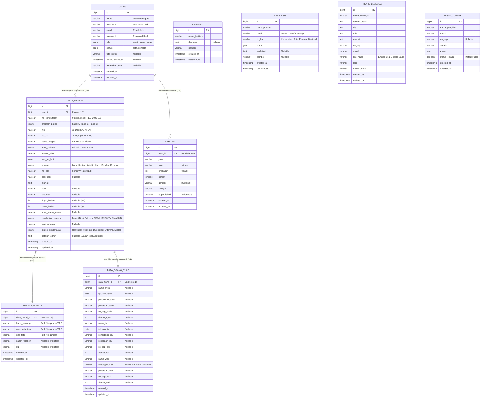

# PENYEMPURNAAN RANCANGAN BASIS DATA & ERD
## Sistem Informasi Profil dan Pendaftaran Siswa Baru PKBM Al Suroya Metro Timur

Dokumen ini merupakan hasil penyempurnaan dari rancangan basis data penelitian sebelumnya dengan memperbaiki seluruh kelemahan tipe data, validasi, kardinalitas, serta mengakomodasi kebutuhan profil institusi dan pendaftaran siswa baru secara menyeluruh sesuai isi BAB I.

---

## 1. Diagram Relasi Entitas (ERD - Crow's Foot Notation)

---

## 2. Rincian Perubahan dan Penyempurnaan yang Dilakukan

| No | Aspek Perubahan | Desain Lama (Kelemahan) | Desain Baru (Penyempurnaan) |
|---|---|---|---|
| 1 | **Tipe Data NIK & KK** | `INT(11)` (Maksimal 10 digit $\rightarrow$ Overflow/Error pada 16 digit) | `VARCHAR(16)` (Presisi tepat 16 digit angka, aman dari pemotongan nilai) |
| 2 | **Jenis Kelamin** | `INT(11)` (Tidak efisien dan tidak semantik) | `ENUM('Laki-laki', 'Perempuan')` |
| 3 | **Pilihan Paket Kesetaraan** | Tidak ada field paket kesetaraan (hanya ada `jenis_kursus`) | Ditambahkan `program_paket` bertipe `ENUM('Paket A', 'Paket B', 'Paket C')` |
| 4 | **Nomor Registrasi Unik** | Tidak ada identitas unik pendaftaran | Ditambahkan `no_pendaftaran` (misal: `REG-2026-0001`) untuk bukti pendaftaran |
| 5 | **Kewajiban Berkas KTP & Ijazah** | `Null: No` (Calon siswa Paket A/anak di bawah 17 th tidak bisa daftar) | `nullable()` (Wajib bagi Paket B/C, opsional bagi Paket A atau non-ijazah) |
| 6 | **Data Orang Tua & Wali** | `Null: No` untuk semua data ayah dan ibu (Mengabaikan yatim/piatu/diasuh wali) | `nullable()` untuk data orang tua, serta disediakan kolom data wali (*guardian*) |
| 7 | **Standar Autentikasi Laravel** | `email_verified_at` dan `remember_token` `Null: No` (Error registrasi bawaan) | Disesuaikan dengan standar Laravel: `nullable()` |
| 8 | **Kardinalitas Akun ke Data Siswa** | 1 ke N (*One-to-Many*) | 1 ke 1 (*One-to-One*) dengan `user_id` unik pada `data_murids` |
| 9 | **Relasi Berkas & Orang Tua** | Langsung terhubung ke `user_id` | Menginduk ke `data_murid_id` sebagai entitas transaksi pendaftaran |
| 10 | **Konten Website Profil** | Tidak ada tabel konten (Website profil menjadi statis/hardcoded) | Ditambahkan tabel `beritas`, `fasilitas`, `prestasis`, `profil_lembaga`, `pesan_kontak` |

---

## 3. Kamus Data Lengkap (Data Dictionary)

### 3.1. Tabel `users`
Digunakan untuk manajemen autentikasi sistem (Role Admin dan Calon Siswa).
- `id`: BIGINT(20), Primary Key, Auto Increment
- `name`: VARCHAR(255), Not Null
- `username`: VARCHAR(100), Unique, Not Null
- `email`: VARCHAR(255), Unique, Not Null
- `password`: VARCHAR(255), Not Null
- `role`: ENUM('admin', 'calon_siswa'), Not Null, Default: 'calon_siswa'
- `status`: ENUM('aktif', 'nonaktif'), Not Null, Default: 'aktif'
- `foto_profile`: VARCHAR(255), Nullable
- `email_verified_at`: TIMESTAMP, Nullable
- `remember_token`: VARCHAR(100), Nullable
- `created_at`: TIMESTAMP, Nullable
- `updated_at`: TIMESTAMP, Nullable

### 3.2. Tabel `data_murids`
Menampung data pribadi calon siswa yang melakukan pendaftaran.
- `id`: BIGINT(20), Primary Key, Auto Increment
- `user_id`: BIGINT(20), Foreign Key $\rightarrow$ `users(id)`, Unique, On Delete Cascade
- `no_pendaftaran`: VARCHAR(50), Unique, Not Null
- `program_paket`: ENUM('Paket A', 'Paket B', 'Paket C'), Not Null
- `nik`: VARCHAR(16), Not Null
- `no_kk`: VARCHAR(16), Not Null
- `nama_lengkap`: VARCHAR(255), Not Null
- `jenis_kelamin`: ENUM('Laki-laki', 'Perempuan'), Not Null
- `tempat_lahir`: VARCHAR(100), Not Null
- `tanggal_lahir`: DATE, Not Null
- `agama`: ENUM('Islam', 'Kristen', 'Katolik', 'Hindu', 'Buddha', 'Konghucu'), Not Null
- `no_telp`: VARCHAR(20), Not Null
- `pekerjaan`: VARCHAR(100), Nullable
- `alamat`: TEXT, Not Null
- `hobi`: VARCHAR(100), Nullable
- `cita_cita`: VARCHAR(100), Nullable
- `tinggi_badan`: INT(4), Nullable
- `berat_badan`: INT(4), Nullable
- `jarak_waktu_tempuh`: VARCHAR(100), Nullable
- `pendidikan_terakhir`: ENUM('Belum/Tidak Sekolah', 'SD/MI', 'SMP/MTs', 'SMA/SMK'), Not Null
- `asal_sekolah`: VARCHAR(150), Nullable
- `status_pendaftaran`: ENUM('Menunggu Verifikasi', 'Diverifikasi', 'Diterima', 'Ditolak'), Default: 'Menunggu Verifikasi'
- `catatan_admin`: TEXT, Nullable
- `created_at`: TIMESTAMP, Nullable
- `updated_at`: TIMESTAMP, Nullable

### 3.3. Tabel `berkas_murids`
Menyimpan file dokumen persyaratan pendaftaran.
- `id`: BIGINT(20), Primary Key, Auto Increment
- `data_murid_id`: BIGINT(20), Foreign Key $\rightarrow$ `data_murids(id)`, Unique, On Delete Cascade
- `kartu_keluarga`: VARCHAR(255), Not Null
- `akte_kelahiran`: VARCHAR(255), Not Null
- `pas_foto`: VARCHAR(255), Not Null
- `ijazah_terakhir`: VARCHAR(255), Nullable (opsional jika belum memiliki ijazah/Paket A)
- `ktp`: VARCHAR(255), Nullable (opsional jika usia < 17 tahun)
- `created_at`: TIMESTAMP, Nullable
- `updated_at`: TIMESTAMP, Nullable

### 3.4. Tabel `data_orang_tuas`
Menyimpan data ayah, ibu, atau wali dari calon siswa.
- `id`: BIGINT(20), Primary Key, Auto Increment
- `data_murid_id`: BIGINT(20), Foreign Key $\rightarrow$ `data_murids(id)`, Unique, On Delete Cascade
- `nama_ayah`: VARCHAR(150), Nullable
- `tgl_lahir_ayah`: DATE, Nullable
- `pendidikan_ayah`: VARCHAR(50), Nullable
- `pekerjaan_ayah`: VARCHAR(100), Nullable
- `no_telp_ayah`: VARCHAR(20), Nullable
- `alamat_ayah`: TEXT, Nullable
- `nama_ibu`: VARCHAR(150), Nullable
- `tgl_lahir_ibu`: DATE, Nullable
- `pendidikan_ibu`: VARCHAR(50), Nullable
- `pekerjaan_ibu`: VARCHAR(100), Nullable
- `no_telp_ibu`: VARCHAR(20), Nullable
- `alamat_ibu`: TEXT, Nullable
- `nama_wali`: VARCHAR(150), Nullable
- `hubungan_wali`: VARCHAR(50), Nullable
- `pekerjaan_wali`: VARCHAR(100), Nullable
- `no_telp_wali`: VARCHAR(20), Nullable
- `alamat_wali`: TEXT, Nullable
- `created_at`: TIMESTAMP, Nullable
- `updated_at`: TIMESTAMP, Nullable

### 3.5. Tabel Konten Website Profil PKBM
1. **`beritas`**: Berita kegiatan, pengumuman jadwal, artikel edukasi PKBM.
2. **`fasilitas`**: Daftar sarana dan prasarana PKBM Al Suroya (ruang kelas, lab komputer, perpustakaan, musholla).
3. **`prestasis`**: Catatan prestasi siswa maupun lembaga.
4. **`profil_lembaga`**: Data dinamis identitas PKBM (visi, misi, sejarah, alamat, no telepon, Google Maps embed).
5. **`pesan_kontak`**: Kotak masuk pertanyaan/pesan dari pengunjung melalui formulir "Hubungi Kami" di halaman landing.

